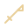

Bir melek. Yedi günah. Tek bir yol.

Yıldız Teknik Üniversitesi · Oyun Tasarımı · Alfa 0.1

<!-- EIGHT tepeden görünümlü bir hayatta kalma oyunu. Tanrı’nın gönderdiği melek, kara öküzünün sırtında cehennemin yedi katını arındırmaya iner. -->

---
class: cast-slide
---

# Yedi kat, yedi günah

  <figure style="--h:#e7a6b5"><b>Odin</b>Kibir</figure>
  <figure style="--h:#f0d483"><b>Midas</b>Açgözlülük</figure>
  <figure style="--h:#eea4cd"><b>Lilith</b>Şehvet</figure>
  <figure style="--h:#9cd6ac"><b>Loki</b>Kıskançlık</figure>
  <figure style="--h:#efae72"><b>Wendigo</b>Oburluk</figure>
  <figure style="--h:#ee8672"><b>Kerberos</b>Gazap</figure>
  <figure style="--h:#99bde7"><b>Edward</b>Tembellik</figure>

 Yedisi düşünce merkezde <b>Şeytan</b> bekler.

<!-- Her günahın kendi diyarı, kendi sürüsü ve kendi saldırı dili var. Her diyara girerken o diyarın sahibi meleğe seslenir. -->

---

# Yolu sen seçersin

Ana menü bir haritadır: yedi günah pentagramın çevresinde, Şeytan merkezde.

İlk günahı oyuncu seçer. Kazanılan her diyar bir mührü kapatır ve o diyarın bir üst zorluğunu açar.

Yedi mühür tamamlanınca merkezin yolu açılır.

<!-- İlerleme kaydedilir. Her düğüm kendi zorluk kademesini gösterir; kazanılan en yüksek kademe "EN İYİ" olarak yazılır. -->

---

# Bir koşunun döngüsü

  
<b>İniş</b>
Melek ışıkla diyara iner.

  <i>→</i>
  
<b>Sürüyü biç</b>
Düşen ruhlar deneyim olur.

  <i>→</i>
  
<b>Beş sunak</b>
Sekiz dakikada hepsini yık.

  <i>→</i>
  
<b>Günahı yen</b>
Son sunakla günah gelir.

  <i>→</i>
  
<b>Geçit</b>
Tüylerle merkeze dön.

Her sunağı, o diyarın günahının zayıf bir kopyası korur. Sunaklar ayaktayken sayaç işler; süre biterse melek düşer.

<!-- Koşu 10-15 dakika sürer. Günah düştükten sonra geçit açılır; melek istediği an çıkabilir, sürü ise güçlenmeye devam eder. -->

---

# Meleğin elleri

  
<b>Işık mızrağı</b>
Üç vuruşluk kombo. Üçüncü vuruş geniş bir yay çizer ve sürüyü yarar.

  
<b>Yay</b>
Üç atışlık kombo. Son ok 1,5 kat vurur ve bir düşmanı deler.

  
<b>Atılma</b>
Kısa dokunulmazlık. İçinden geçtiğin her düşmana bir mızrak darbesi vurur ve onu iter.

  
<b>Uçuş</b>
Space basılıyken yükselir. Yerdeki saldırıların üstünden geçer, dayanıklılık harcar.

<b>Kusursuz kaçış:</b> bir darbe atılmanın ilk anına denk gelirse ıskalar, atılma hemen yenilenir ve saldırılar iki saniye hızlanır.

<!-- Kontroller: WASD hareket, fare nişan, sol tık saldırı, Q silah değiştir, Space uç, Shift atıl. F1 kontrolleri gösterir; saldırı ve atılma tuşları Ayarlar'dan değiştirilebilir. -->

---

# Uyarıların dili

  
<b>Köz rengi: yerden</b>
Hücum hatları, halkalar, yere vuruşlar. <strong>Üstünden uç</strong> ya da <strong>içinden atıl</strong>.

  
<b>Mor: havadan</b>
Yağmur, öpücükler, cehennem ateşi. Uçmak kurtarmaz: <strong>alandan çık</strong> ya da <strong>atıl</strong>.

Her saldırı önce çizilir, sonra vurur, sonra bir açık bırakır. Çizilen ne ise vuran odur.

<!-- Bu kural sekiz patronun hepsinde aynı. Oyuncu bir kez öğrendikten sonra her yeni patronu okuyabilir. -->

---

# Işıkta kalmak mı, ilerlemek mi?

Yıkılan sunağın çevresine gökten ışık iner.

10 saniye

Halkanın içinde dayanırsan canının dörtte biri geri gelir. Dışarı çıkarsan sayaç başa döner. Her sunak bir kez şifa verir.

<!-- Şifa bedava değil: oyuncu dar bir alanda saldırılara dayanmak zorunda, içerideyken diğer sunakların süresi işliyor. -->

---

# Güçlenmek

<b>Seviye</b> · Her seviyede oyun durur, üç karttan biri seçilir: hasar, hız, zırh, menzil…

<b>Evrim</b> · Muhafızlar evrim eşyası düşürür. Her silah bir kez evrilir: KasırgaZincir IşıkSekmeIşık Yağmuru

<b>Yan silahlar</b> · Sandıklardan ve muhafızlardan; aynısı gelirse III'e kadar güçlenir: Yörünge HaleleriGüdümlü TüylerKutsal NabızYargı Şimşeği

<!-- Seviye kartları bu koşuyu değiştirir; evrim yolları silahın bitiricisini değiştirir. -->

---

# Sunak antlaşmaları

Bir sunak yıkılınca iki antlaşma sunulur. Biri alınır ya da hiçbirine el sürülmez. Koşu başına en fazla üç.

<ul class="pacts">
<li><b>Cam Işık</b>+%25 hasar, −%25 azami can</li>
<li><b>Altın Öşür</b>+%50 tüy, kalpler yarı sıklıkta</li>
<li><b>Çevik Kan</b>Saldırı ve atılma %15 hızlı, düşmanlar %20 sert</li>
</ul>

<!-- Her antlaşma bir güç verir, bir bedel ister. Risk oyuncunun elinde. -->

---

# Tüy ve dükkân

Öldürme <b>1</b> · Muhafız <b>10</b> · Sunak <b>15</b> · Günah <b>50</b> · Şeytan <b>100</b>

Zaferde tüylerin hepsi, yenilgide yarısı saklanır.

Merkezdeki dükkânda sekiz kalıcı güç, her biri beş kademe: DirilikKudretZırhSüratŞansÇeviklikÇekimKanatlar

<!-- Satın alınan güç sonraki her koşuya taşınır. Zorluk kademesi kazanılan tüyü katlar. -->

---

# Zorluk ve her koşunun farkı

  
<b>Kefaret</b>×1 tüy
<i>→</i>
  
<b>Araf</b>×1,5 tüy
<i>→</i>
  
<b>Lanet</b>×2 tüy
<i>→</i>
  
<b>Uçurum</b>×3 tüy

Bir günahı bir kademede yenmek o günahın bir sonraki kademesini açar. Kademe yükseldikçe sürü kalabalıklaşır, patronlar yeni hamleler öğrenir. Süre hiç kısalmaz.

  
<b>Seçkinler</b>
Nadir, güçlü düşmanlar. Ayaklarında halka, kesin tüy ödülü.

  
<b>Sürü Dalgası</b>
Arada bir yirmi saniyelik akın; ekranda duyurulur.

  
<b>Kavrulmuş Toprak</b>
Üç koşuda bir: lav daha sık ve sert yakar, tüy ×1,25.

---

# Sürü

  <figure><b>Kabuk</b>Yavaş, kalabalık</figure>
  <figure><b>İfrit</b>Hızlı, kanatlı</figure>
  <figure><b>İri</b>Ağır, dayanıklı</figure>

  <b>Hücumcu</b>Kibir · Gazap
  <b>Yer büyücüsü</b>Açgözlülük · Şehvet
  <b>Bombacı</b>Gazap
  <b>Bölünen</b>Oburluk · Kıskançlık
  <b>Kalkanlı</b>Kibir
  <b>Havan</b>Tembellik · Açgözlülük
  <b>Uyuyan</b>Tembellik
  <b>Ayna</b>Kıskançlık

<!-- Her diyarın sürüsü günahına göre karışır; yeni türler koşunun ilk dakikalarında sırayla katılır. Şeytan'ın diyarında hepsi bir arada. -->

---
class: realm
---

<h1>Odin</h1>
I · Kibir · 100 can

<q>Burada ışık bile eğilir.</q>
<ol class="rail">
<li><em>%100</em>
<b>Nişanlı yelpaze ve hücum</b>
Yerdeki köz hattı hücumun ilk engele kadar yolunu gösterir.

</li>
<li><em>%50</em>
<b>Kalkan duruşu, ardından yere vuruş</b>
1,5 saniye önünden gelen darbeyi keser, sonra 110 px'lik bir halka iner.

</li>
</ol>

Hattan yana çekilKalkanı bitiricin kırarHalkanın üstünden uç

Sürü: dengeli · Hücumcu · Kalkanlı

<!-- Kibir'in derdi gurur: önünden geçilmez. Bitirici ya da arkadan gelen darbe kalkanı kırar ve Odin 1,2 saniye açık kalır. -->

---
class: realm
---

<h1>Midas</h1>
II · Açgözlülük · 130 can

<q>Geçmek için ne vereceksin?</q>
<ol class="rail">
<li><em>%100</em>
<b>Altın halkaları</b>
On iki yöne sikke saçar; nişan aldığı atışın iki yanında boşluk bırakır. Yer büyücüleri çağırır.

</li>
<li><em>%60</em>
<b>Altın yağmuru</b>
Meleğin çevresine sırayla beş mor daire düşer.

</li>
<li><em>%25</em>
<b>Sarmal</b>
Halkalar dönerek gelir; sarmalla birlikte adım at.

</li>
</ol>

Boşluğa adım atYağmurdan atılSikkelerin üstünden uç

Sürü: ifritler · Yer büyücüsü · Havan

<!-- Açgözlülük her şeyi ister: ekranı sikkeyle doldurur ama her halkada bir kapı bırakır. -->

---
class: realm
---

<h1>Lilith</h1>
III · Şehvet · 110 can · en hızlı

<q>Kal. Işık bekleyebilir.</q>
<ol class="rail">
<li><em>%100</em>
<b>Hücum ve öpücükler</b>
Üç yavaş, mor öpücük havadan gelir; uçmak kurtarmaz.

</li>
<li><em>%50</em>
<b>Göz kırpma</b>
Meleğin 120 px arkasında bir daire belirir; Lilith oraya ışınlanıp hemen hücum eder.

</li>
</ol>

Öpücüklerin içinden atılİşaretli noktaya bas, ışınlanma bozulur

Sürü: ifritler · uçanlar · Yer büyücüsü

<!-- Şehvet meleği oyalamak ister: arkasında belirir. Oyuncu işaretli noktaya basarsa ışınlanma iptal olur. -->

---
class: realm
---

<h1>Loki</h1>
IV · Kıskançlık · 165 can

<q>O ışık kimin elinde olduğunu biliyor mu?</q>
<ol class="rail">
<li><em>%100</em>
<b>Ayna</b>
Meleğin silahını kopyalar. Mızrağa karşı 120 px'lik saplama, yaya karşı 340 px'ten üç hızlı atış.

</li>
<li><em>%60</em>
<b>Sahte kopya</b>
Yanında karanlık bir ikizi belirir. İsim etiketi ve can barı yalnızca gerçeğinde var.

</li>
</ol>

Saplama hattından çekilEtiketli olanı vurHattın üstünden uç

Sürü: uçanlar · Bölünen · Ayna

<!-- Kıskançlık sahip olmadığını ister: meleğin silahını taklit eder. Silah değiştirmek Loki'nin taktiğini de değiştirir. -->

---
class: realm
---

<h1>Wendigo</h1>
V · Oburluk · 220 can

<q>Yutulacak bir ışık daha.</q>
<ol class="rail">
<li><em>%100</em>
<b>Sıçrama ve kusma</b>
Meleğin üstüne 120 px'lik bir daireyle iner, ardında 4 saniyelik safra bırakır.

</li>
<li><em>%50</em>
<b>Yutma</b>
Ağzı meleği ve sürüyü çeker. Ağza ulaşan düşman yok olur; ağızda kalan melek ısırılır.

</li>
<li><em>%20</em>
<b>Bölünenler</b>
Ölünce ikiye ayrılan yaratıklar çağırır.

</li>
</ol>

Safranın üstünden uçAtılma çekimi yok sayar

Sürü: iriler · Bölünen

<!-- Oburluk doymaz: kendi sürüsünü bile yer ama asla iyileşmez. Yutma sırasında atılmak çekimden kurtarır. -->

---
class: realm
---

<h1>Kerberos</h1>
VI · Gazap · 200 can

<q>Üç ağız. Tek kapı.</q>
<ol class="rail">
<li><em>%100</em>
<b>Çift hücum, yere vuruş</b>
İki hücum arka arkaya, durduğu yerde 90 px'lik bir vuruş.

</li>
<li><em>%50</em>
<b>Öfke</b>
%20 hızlanır; her hücumdan sonra bir mermi halkası.

</li>
<li><em>%20</em>
<b>Şok dalgası</b>
Üç köz halkası 0,45 saniye arayla dışa yayılır.

</li>
</ol>

Hücum hattından çekilHalkaların üstünden uçAralarından atıl

Sürü: ifritler · iriler · Hücumcu · Bombacı

<!-- Gazap hiç durmaz: canı azaldıkça hızlanır. Bombacıları ona doğru çekmek, patlamalarını ona karşı kullanmaktır. -->

---
class: realm
---

<h1>Edward</h1>
VII · Tembellik · 240 can

<q>Mızrağını bırak. Dinlen.</q>
<ol class="rail">
<li><em>%100</em>
<b>Horlama ve çamur</b>
Yavaş bir mermi halkası; çamur birikintileri yürüyüşü %60'a düşürür.

</li>
<li><em>%65</em>
<b>Esneme</b>
1,4 saniyelik uyarıyla 320 px'lik dev vuruş; ardından iki saniye uyur.

</li>
<li><em>%25</em>
<b>Uyanış</b>
Kızarır, iki buçuk kat hızlanır ve hücum etmeye başlar.

</li>
</ol>

Esnemenin üstünden uçUykusunda vur

Sürü: yavaş kabuklar · Uyuyan · Havan

<!-- Tembellik meleği yavaşlatır ve uyutmaya çalışır. Esnemeden sonraki uyku, en büyük hasar fırsatıdır. -->

---
class: realm
---

<h1>Şeytan</h1>
Merkez · 520 can · 40 sn ritüel

<q>Yedi mühür seni bana getirdi.</q>
<ol class="rail">
<li><em>%100</em>
<b>Cehennem ateşi</b>
Havadan mor yelpazeler, hücum ve yağmur.

</li>
<li><em>%66</em>
<b>Yedi imza</b>
Yedi günahın hamlesi pentagram sırasıyla.

</li>
<li><em>%33</em>
<b>Pentagram</b>
Beş ışın 500 px uzanır, köz ve mor sırayla. Ortadaki beşgen güvenlidir.

</li>
</ol>

Köz ışından uçMordan çık ya da atıl

Sürü: yedi diyarın hepsi

<!-- Final, tüm oyunun özeti: her günahın imzası tek dövüşte. Zafer meleği yükseltir ve dünyayı iyileştirir. -->

---

# Sıradaki adım

Tasarımı hazır, henüz oyunda değil

  
<b>Tarot</b>
Her beş seviyede üç karttan biri. Biri bedel ister, biri sürüyü akıllandırır: bir tür hariç tüm yaratıkların saldırı deseni değişir.

  
<b>Parkur</b>
Üzerine çıkılabilen engeller ve ağaçlar. Sürüden yukarıda nefes alıp yeniden saldırı açısı bulmak için.

<!-- Bu ikisi Oyun Dinamikleri ve Akış dokümanlarından geliyor. Amaç aynı: her beş seviyede kuralları esnetmek ve haritayı taktik bir alana çevirmek. -->

---
layout: center
class: closing
---

Sizce melek ışıkta kalmalı mı, yoksa ilerlemeli mi?

Canlı gösterim · Kibir diyarı

<!-- Canlı gösterimde Kibir'e girip ilk muhafızın saldırı hazırlığını göster. Tartışmayı jüriye bu soruyla aç. -->
